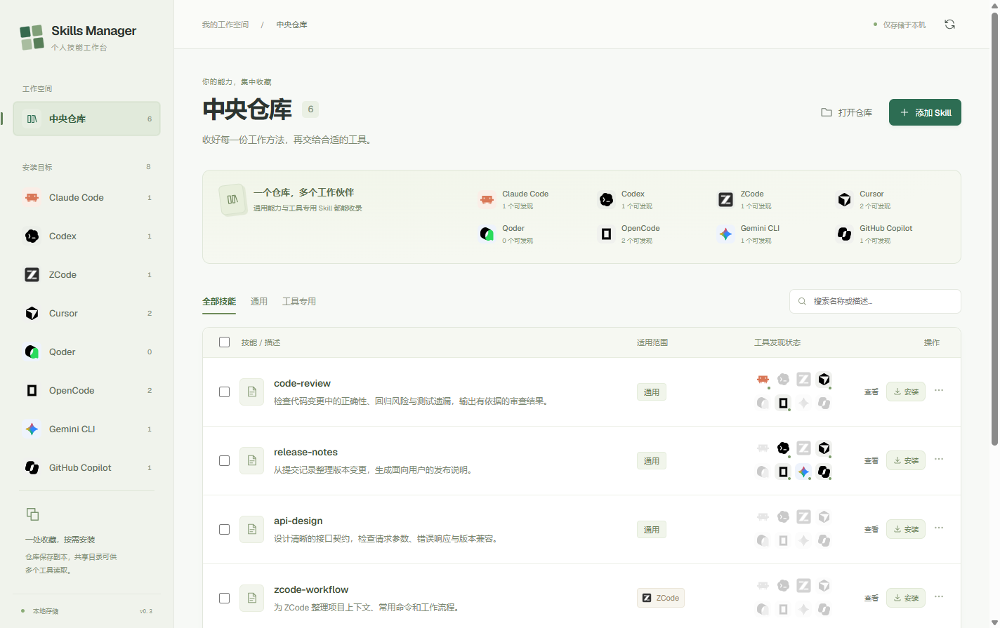

# Skills Manager

面向 Claude Code、Codex、ZCode、Cursor、Qoder、OpenCode、Gemini CLI 和 GitHub Copilot 的本地 Skill 管理桌面应用。将技能集中收藏到中央仓库，再按需复制安装到不同工具。

基于 **Electron + React + TypeScript**，提供 Windows 和 macOS 打包配置。当前开发验证在 Windows 上完成，macOS 仍需实机验证。



## 功能

| 功能           | 说明                                                          |
| -------------- | ------------------------------------------------------------- |
| 中央仓库       | 从本地目录、公开 HTTPS Git 仓库或工具现有目录收录独立副本     |
| 多工具兼容范围 | 标记为通用或同时选择多个工具；安装列表按适用范围筛选          |
| 复制安装       | 在仓库选择目标工具，或在工具页面勾选批量安装；同名内容不覆盖  |
| 已发现管理     | 扫描用户级及共享 / 兼容目录，展示管理方式、读取工具与仓库关联 |
| 内容浏览       | Markdown 预览、完整源码、附属文件切换，支持 Esc 关闭          |
| 文件保护       | 安装失败回滚，卸载前检查文件变化；删除使用回收站或保留备份    |

中央仓库与工具目录使用独立副本，**不会自动同步**。多个工具可能读取同一份共享目录文件。适用范围是用户标记，不代表应用已经验证内容可以在该工具中运行，也不能限制其他工具读取共享文件。

## 使用流程

### 添加到中央仓库

在“中央仓库”点击 **添加 Skill**，选择本地目录或输入公开 HTTPS Git 仓库地址，勾选检测到的技能，再指定适用范围并收入仓库。Git 导入需要系统已安装 Git。

也可以进入工具页面，在已有 Skill 行点击 **收录**。默认标记为来源工具专用，可以改为通用或勾选多个工具；收录不会移动或修改原文件。旧版本保存的单工具标记会自动读取为单元素列表，文件位置和安装关联保持不变。

### 安装到工具

- 在中央仓库选择一个或多个 Skill，点击 **选择安装目标**，勾选工具后复制安装。
- 或进入工具页面，切换到 **从仓库选择**，勾选需要的 Skill 安装。

安装完成后，按工具页面提示刷新列表、重启或开启新会话。ZCode 还需要确认启用开关。**已发现**表示扫描目录中存在文件，不代表目标工具已安装、Skill 已启用或运行依赖齐全。本机用户级 Skill 不会因此自动同步到云端 Agent。

安装前检查目标工具能发现的全部已扫描目录，发现同名 Skill 时阻止重复安装。一次明确选择多个目标仍会为每个目标目录分别复制；如果这些工具也会互相读取兼容目录，同名技能的实际加载优先级由目标工具决定。

### 浏览、卸载与删除

点击 Skill 名称或 **查看** 阅读内容。单文件预览支持 UTF-8 文本，上限 1MB；内部链接、二进制和其他编码文件不在预览范围内，远程图片不会加载。

更多操作位于每行右侧的菜单：

| 操作                         | 结果与恢复方式                                                                          |
| ---------------------------- | --------------------------------------------------------------------------------------- |
| 应用管理的 Skill：卸载       | 检查文件哈希；发现修改、新增或删除时停止。正常卸载保留原目录旁的 `.removed-<uuid>` 备份 |
| 外部已有的 Skill：移入回收站 | 确认后移入系统回收站，可从回收站还原                                                    |
| 仓库 Skill：移出仓库         | 仓库副本移入回收站，工具中已安装的副本保留                                              |

隐藏备份不会自动清理。手动恢复时，可将备份改回原技能目录名；恢复后的内容会被视为外部已有 Skill。链接目录暂不支持直接收录、复制或删除，请选择真实来源目录。

**共享目录中的文件只有一份。** 同一个 Skill 可同时出现在多个工具页面，但不会生成多条安装记录。卸载或删除确认框会列出所有读取此目录的工具；执行后，这些工具都会失去对这份文件的发现结果，其他目录中的独立副本保留。

## 本地开发

推荐 Node.js **24**（见 `.nvmrc`）；最低 Node.js **22.13**、npm **10**。Git 来源导入还需要系统 Git。

```sh
git clone https://github.com/handsometaoa/skills-manager.git
cd skills-manager
npm ci
npm run dev
```

`npm ci` 使用已提交的锁文件安装依赖。首次安装会下载 Electron 运行时，需要正常访问对应的下载源。

### 常用命令

| 命令                   | 用途                                             |
| ---------------------- | ------------------------------------------------ |
| `npm run dev`          | 启动 Electron 开发环境                           |
| `npm run format`       | 使用 Prettier 格式化代码与文档                   |
| `npm run format:check` | 只检查格式                                       |
| `npm run lint`         | ESLint 与 React Hooks 检查                       |
| `npm run typecheck`    | TypeScript 类型检查                              |
| `npm test`             | 单元测试及真实临时目录中的集成测试               |
| `npm run check`        | 顺序运行格式、lint、类型与单元/集成测试          |
| `npm run build`        | 类型检查并构建到 `out/`                          |
| `npm run test:ui`      | 对构建产物运行 Electron 界面回归，需先执行 build |
| `npm run pack`         | 构建并生成当前系统未安装的应用目录               |
| `npm run dist`         | 构建并生成当前系统安装包                         |

日常提交前建议运行：

```sh
npm run check
npm run build
npm run test:ui
```

界面测试使用模拟 IPC 数据，截图写入 `out/qa/`；核心测试使用临时目录，不修改实际工具中的 Skill。测试细节和模块边界见 [架构说明](docs/architecture.md)。

## 项目结构

```text
src/
├── main/                       # Electron 主进程
│   ├── index.ts                # 入口
│   ├── bootstrap.ts            # 应用生命周期与服务组装
│   ├── window.ts               # 窗口配置
│   ├── adapters/               # 工具目录与适配规则
│   ├── ipc/                    # IPC 注册、来源校验与参数校验
│   ├── services/               # Skill 业务、解析、浏览与 Git 来源
│   ├── filesystem/             # 文件哈希等底层操作
│   └── storage/                # 持久化记录与 JSON 写入
├── preload/                    # contextBridge API
├── renderer/
│   ├── public/                 # 静态公共资源
│   └── src/
│       ├── App.tsx             # 应用布局与功能组合
│       ├── components/         # 公共布局和 UI 组件
│       ├── features/           # library、skills、workspace
│       ├── lib/                # 纯辅助函数
│       ├── styles/             # 应用与内容浏览样式
│       └── assets/             # 本地图标
└── shared/                     # 领域模型、API 类型和 IPC 通道
tests/
├── unit/                       # 纯逻辑与协议约束
├── integration/                # 文件系统与业务流程
└── ui/                         # Electron 界面回归
docs/                           # 架构说明与界面截图
```

## 数据位置

### 工具目录

| 工具            | 用户级安装目录              |
| --------------- | --------------------------- |
| Claude Code     | `~/.claude/skills`          |
| Codex           | `~/.agents/skills`          |
| ZCode           | `~/.zcode/skills`           |
| Cursor          | `~/.cursor/skills`          |
| Qoder IDE / CLI | `~/.qoder/skills`           |
| OpenCode        | `~/.config/opencode/skills` |
| Gemini CLI      | `~/.gemini/skills`          |
| GitHub Copilot  | `~/.copilot/skills`         |

`~` 由系统主目录解析。例如 Windows 的 `C:\Users\用户名`、macOS 的 `/Users/用户名`。不依赖工具是否安装，目录不存在时扫描跳过，实际安装时创建。

除默认安装目录外，还扫描以下用户级兼容目录，并在工具页面展示完整路径与读取关系：

| 工具                       | 额外扫描目录                                              |
| -------------------------- | --------------------------------------------------------- |
| Cursor                     | `~/.agents/skills`、`~/.claude/skills`、`~/.codex/skills` |
| OpenCode                   | `~/.agents/skills`、`~/.claude/skills`                    |
| Gemini CLI、GitHub Copilot | `~/.agents/skills`                                        |

Codex 保留既有的 `~/.agents/skills` 安装位置，因此复制安装到 Codex 后，Cursor、OpenCode、Gemini CLI 和 Copilot 也可能发现这份文件。Cursor 对 `.codex/skills` 的兼容读取不表示当前 Codex 一定读取该历史目录。当前只扫描这些根目录的直接 Skill 子目录，不覆盖所有工具可能支持的递归发现、项目级、插件、环境变量自定义或远程路径。

目录依据：[Cursor](https://cursor.com/docs/context/skills)、[Qoder IDE](https://docs.qoder.com/extensions/skills)、[Qoder CLI](https://docs.qoder.com/cli/Skills)、[OpenCode](https://opencode.ai/docs/skills/)、[Gemini CLI](https://github.com/google-gemini/gemini-cli/blob/main/docs/cli/skills.md)、[GitHub Copilot](https://docs.github.com/en/copilot/concepts/agents/about-agent-skills)。规则随工具版本变化，接入验证以当前本机版本为准。

### 中央仓库与安装记录

为保留改名前的数据，应用继续使用原目录名：

| 环境   | Windows                  | macOS                                        |
| ------ | ------------------------ | -------------------------------------------- |
| 发布版 | `%APPDATA%/Skill Manage` | `~/Library/Application Support/Skill Manage` |
| 开发版 | `%APPDATA%/skill-manage` | `~/Library/Application Support/skill-manage` |

```text
应用数据目录/
├── library.json                # 仓库来源、适用范围与收录时间
├── installations.json          # 安装来源、文件哈希及仓库关联
└── library/
    └── <uuid>/<skill-name>/    # Skill 完整副本
```

备份应用数据时，请同时保存两个 JSON 文件和 `library/`；已安装的工具副本位于各工具目录，需要另外备份。已有文件不会自动迁移到中央仓库，可从工具页面手动收录。

## 打包与发布

Windows 的 NSIS 安装包在 Windows 上构建，macOS 的 DMG 在 macOS 上构建，默认输出到 `release/`。未安装的 Windows 应用需要保留整个 `win-unpacked/` 文件夹。

当前未配置代码签名证书与 macOS 公证，也未提供自动更新。GitHub Actions 在 Windows 上运行检查、构建和界面测试；尚未验证 macOS 的完整安装与运行流程。

## 当前限制

- 不支持覆盖升级、自动同步、项目级安装、启停控制、链接安装和远程主机。
- Git 导入仅支持公开 HTTPS 仓库，不提供私有仓库认证、子模块下载或提交版本管理。
- 自动发现最多扫描四层子目录，每次最多导入 200 个 Skill。
- 要求 `SKILL.md` 包含非空 `name`、`description`。当前目录名仅接受字母、数字、点、短横线和下划线，并排除部分 Windows 保留名称。
- ZCode 安装会阻止超过 1024 字符的描述，正文超过 100KB 时提示。规则参考 [ZCode Skill 文档](https://zcode.z.ai/cn/docs/skill)。
- OpenCode 安装要求目录名与 YAML `name` 一致，且为不超过 64 字符的小写字母、数字和单短横线，描述不超过 1024 字符；不符合时停止整批安装。
- 不自动转换工具专用指令，也不安装 Skill 依赖。请自行确认 Skill 内容和运行环境。
- 不提供多实例写入锁或断电后的自动事务恢复，使用时请避免多个应用实例同时修改同一仓库。

## 贡献与许可

开发约定见 [CONTRIBUTING.md](CONTRIBUTING.md)，模块职责见 [docs/architecture.md](docs/architecture.md)。

代码使用 [MIT License](LICENSE)。工具图标和字体的归属及许可见 [THIRD_PARTY_NOTICES.md](THIRD_PARTY_NOTICES.md) 与 [FONT_LICENSE.txt](FONT_LICENSE.txt)。Skills Manager 是独立项目，与所支持的工具不存在官方隶属关系。
