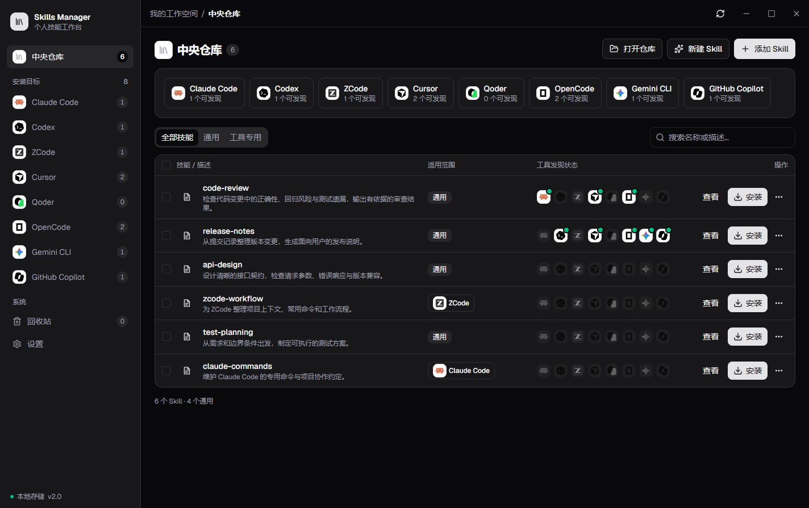

# Skills Manager

面向 Claude Code、Codex、ZCode、Cursor、Qoder、OpenCode、Gemini CLI 和 GitHub Copilot 的本地 Skill 管理桌面应用。集中收藏到中央仓库，按需复制安装到各工具与项目。

| 中央仓库（明亮）                           | 中央仓库（黑暗）                          |
| ------------------------------------------ | ----------------------------------------- |
|  |  |

## ✨ 功能

- **中央仓库**：从本地目录 / 公开 Git 仓库 / 工具现有目录收录独立副本，一键创建 SKILL 模板
- **复制安装**：选择目标工具批量安装；同名内容不覆盖
- **一键下发更新**：仓库内容修订后，一键同步到所有安装过该 Skill 的工具目录（自动跳过已同步副本）
- **项目级管理**：添加项目文件夹，扫描 / 安装 / 收录 / 删除 / 从仓库更新项目内各 Agent 目录的 Skill
- **内容浏览与编辑**：Markdown 预览、语法高亮源码、IDEA 式文件树、直接编辑保存
- **回收站**：删除进入应用回收站，可还原或永久删除
- **设置**：主题（跟随系统 / 明亮 / 黑暗）、中央仓库位置、各 Agent 扫描目录与启用停用

> 说明：仓库与工具目录使用独立副本，不会自动同步（可一键下发）；多个工具可能读取同一份共享目录。适用范围是用户标记，不限制其他工具读取共享文件。

## 📦 安装

从 [Releases](https://github.com/handsometaoa/skills-manager/releases) 下载：

- **Windows**：`Skills-Manager-Setup-x.y.z.exe`（未签名，首次运行如遇 SmartScreen 提示，选择"仍要运行"）
- **macOS**：`Skills-Manager-x.y.z-{x64,arm64}.dmg`，拖入 Applications

**macOS 提示"应用已损坏 / 无法打开"**：应用未做签名与公证，首次打开需移除 quarantine 标记：

```sh
sudo xattr -rd com.apple.quarantine "/Applications/Skills Manager.app"
```

之后即可正常打开。彻底解决需要开发者签名与公证（尚未配置）。

## 🚀 使用

- **收录**：中央仓库 → 添加 Skill（本地目录 / Git 仓库），或在工具页面点击 **收录**
- **安装**：仓库勾选 Skill → 选择目标工具复制安装；安装后按工具提示刷新或开启新会话
- **下发更新**：修订仓库内容后，在条目菜单点击 **下发更新到工具**，覆盖同步所有已安装副本（已同步的自动跳过）
- **项目管理**：侧边栏 **项目** → 添加项目文件夹 → 扫描 / 从仓库安装 / 收录 / 删除项目内 `.claude/skills` 等 7 个 Agent 目录的 Skill；通过仓库安装的项目 Skill 支持 **从仓库更新**
- **浏览与编辑**：点击 Skill 名称查看，IDEA 式文件树 + 语法高亮，编辑模式可直接修改（Ctrl/Cmd+S 保存）
- **设置**：主题模式、中央仓库位置（可迁移，自动搬运现有内容）、各 Agent 扫描目录与启用停用

删除的 Skill 统一进入应用回收站，可还原到原路径或永久删除。

## 🧰 支持的工具

| 工具           | 用户级目录                  | 项目级目录（项目内） |
| -------------- | --------------------------- | -------------------- |
| Claude Code    | `~/.claude/skills`          | `.claude/skills`     |
| Codex          | `~/.agents/skills`          | `.agents/skills`     |
| ZCode          | `~/.zcode/skills`           | 暂不支持             |
| Cursor         | `~/.cursor/skills`          | `.cursor/skills`     |
| Qoder          | `~/.qoder/skills`           | `.qoder/skills`      |
| OpenCode       | `~/.config/opencode/skills` | `.opencode/skills`   |
| Gemini CLI     | `~/.gemini/skills`          | `.gemini/skills`     |
| GitHub Copilot | `~/.copilot/skills`         | `.github/skills`     |

部分工具还会互相读取兼容目录（如 Cursor / OpenCode / Gemini / Copilot 会读取 `~/.agents/skills` 与 `~/.claude/skills`），应用扫描时会自动标注共享关系。目录依据：[Cursor](https://cursor.com/docs/context/skills)、[Qoder](https://docs.qoder.com/extensions/skills)、[OpenCode](https://opencode.ai/docs/skills/)、[Gemini CLI](https://github.com/google-gemini/gemini-cli/blob/main/docs/cli/skills.md)、[GitHub Copilot](https://docs.github.com/en/copilot/concepts/agents/about-agent-skills)。

## 🗂 数据位置

应用数据（发布版）：`%APPDATA%/Skill Manage`（Windows）或 `~/Library/Application Support/Skill Manage`（macOS），含 `library.json`、`installations.json`、`settings.json`、`library/` 与 `trash/`。备份时请保存整个目录；各工具目录中的副本需另行备份。

## ⌨️ 开发

推荐 Node.js **24**；Git 来源导入需要系统 Git。

```sh
git clone https://github.com/handsometaoa/skills-manager.git
cd skills-manager
npm ci
npm run dev
```

| 命令              | 用途                               |
| ----------------- | ---------------------------------- |
| `npm run dev`     | 启动 Electron 开发环境             |
| `npm run check`   | 格式 + lint + 类型 + 单元/集成测试 |
| `npm run test:ui` | Electron 界面回归（需先 build）    |
| `npm run dist`    | 构建当前系统安装包                 |
| `npm run icons`   | 从 `icon.svg` 重新生成应用图标     |

发布：`npm version patch && git push --follow-tags` 会触发 GitHub Actions，在 Windows 与 macOS runner 上构建并附加到 Release；应用内置自动更新（electron-updater + GitHub Releases）。

模块边界与测试层级见 [架构说明](docs/architecture.md)。

## ⚠️ 已知限制

- 仓库更新不会自动同步（提供一键下发）；不支持链接安装和远程主机。
- 项目级管理支持除 ZCode 外的 7 个工具（ZCode 官方未明确项目级目录）。
- Git 导入仅支持公开 HTTPS 仓库；自动发现最多四层子目录，单次最多 200 个 Skill。
- macOS 自动更新的安装步骤需要签名与公证（下载阶段不受影响）。

## 📄 许可

[MIT License](LICENSE)。工具图标与字体的归属见 [THIRD_PARTY_NOTICES.md](THIRD_PARTY_NOTICES.md)。Skills Manager 是独立项目，与所支持的工具无官方隶属关系。
